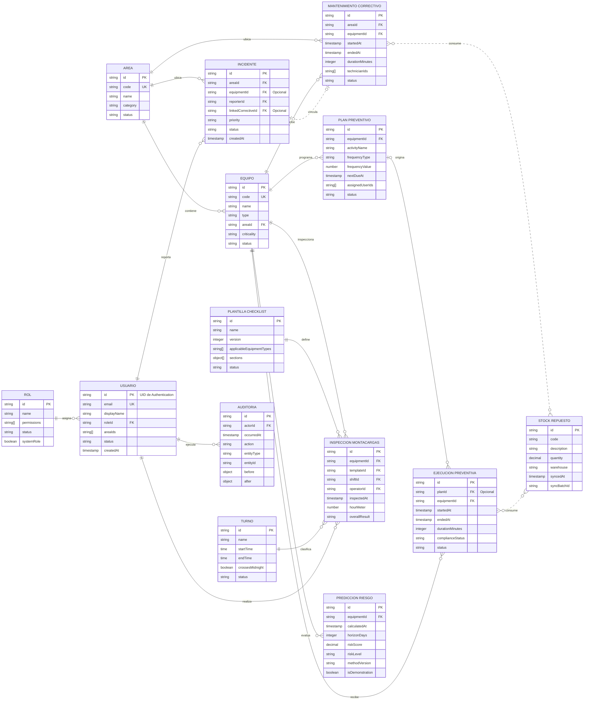

# CeroFallas — Modelo entidad–relación

Fecha: 2026-09-06

Estado: MODELO LÓGICO BASADO EN EL DISEÑO VIGENTE

Este diagrama resume las entidades, claves y cardinalidades principales descritas en `data-model.md`. En Cloud Firestore las referencias se almacenan como identificadores y, cuando se necesita preservar el histórico, también como snapshots desnormalizados. Por ello las marcas `FK` representan relaciones lógicas, no restricciones físicas de una base SQL.

Diagrama editable: [CeroFallas — Modelo entidad–relación en FigJam](https://www.figma.com/board/2XJOWJFPRR5MPuotQf4idR)

## Alcance y pendientes

- `ROL`, `ÁREA`, `TURNO` y `PLANTILLA_CHECKLIST` son catálogos lógicos; parte de ellos permanece configurada en código mientras se valida su administración futura.
- La relación entre incidentes y correctivos es opcional en ambos sentidos.
- Una ejecución preventiva puede ser extraordinaria y no pertenecer a un plan.
- Los repuestos utilizados se conservan actualmente como snapshots dentro del mantenimiento; la relación con stock es conceptual y no modifica SAP.
- Las predicciones continúan en modo demostrativo hasta recibir histórico autorizado y validar el modelo.
- Permanecen pendientes los catálogos reales de equipos, fallas, componentes, turnos y datos de integración con SAP.
